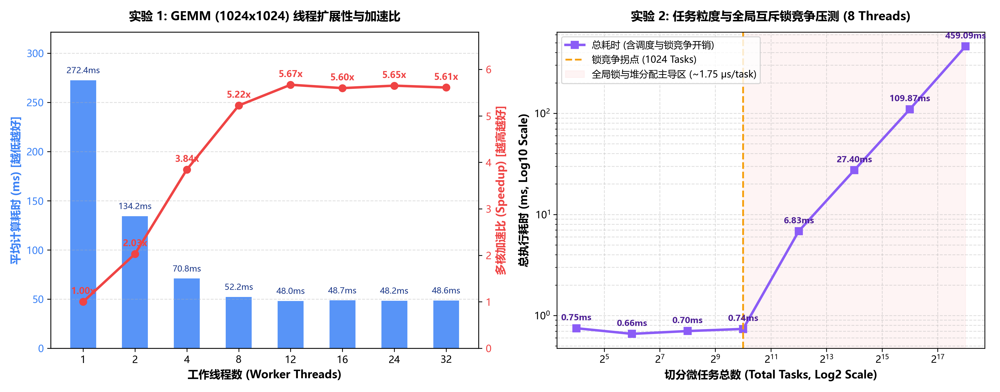

# v2.3 压测方法论校准与全局锁极限瓶颈量化报告

针对 `v2.2` 首轮测试中暴露的“冷启动偏差”、“单次采样抖动”以及“高算术强度掩盖锁开销”三大问题，本版本（`v2.3`）对基准测试套件（`benchmark_gemm.cpp`）进行了方法论升级，并通过自动化绘图脚本生成了双维度性能剖析图表。

---

## 一、 v2.3 压测套件的三大工程升级

1. **引入硬件与缓存预热（Warm-up Phase）**：
   在正式计时前先空跑一轮完整的 `1024 x 1024` 矩阵乘法，确保 24MB 虚拟内存完成物理页映射（消除缺页中断 Page Faults）、CPU 各级缓存（L1/L2/L3 Cache）充分预热，且处理器频率稳定在全核最高睿频。
2. **多次采样均值滤波（Iterations = 3）**：
   单线程基准与实验 1 的每个线程梯度均连续执行 3 轮完整矩阵乘法并取算术平均值，同时在迭代间复用线程池实例，剥离操作系统线程创建销毁与偶发后台中断带来的测量毛刺。
3. **极端微任务锁竞争压测（16 ~ 262,144 Tasks）**：
   重构实验 2 负载，固定 8 个工作线程与 `1,048,576` 次总运算量，将任务切分包数量从 `16` 指数级推高至 `262,144` 个微任务，降低单个任务内部的纯计算耗时占比，从而在极端并发下真实测量 `queue_mutex_` 互斥锁竞争与 `std::make_shared` 堆分配的固定开销。

---

## 二、 v2.3 实测数据记录与可视化图表

### 1. 实验 1：线程扩展性测试 (`scaling`, `N = 1024`, `Chunk = 16 Rows`, 3 次平均)

* **主线程裸跑平均耗时**：`497.77 ms`
* **单工作线程基准耗时 (`T1`, `Threads = 1`)**：`272.39 ms`

| 工作线程数 (`param`) | 平均计算耗时 (`time_ms`) | 表观加速比 (相对主线程 `497.77ms`) | 真实强扩展加速比 (`T1 / Tp`) | 并行效率 (`Speedup / Threads`) | 状态特征解读 |
| :---: | :---: | :---: | :---: | :---: | :--- |
| **1** | 272.39 ms | 1.83x | **1.00x (基准)** | 100.0% | 单核工作线程满血基准 (`T1`) |
| **2** | 134.21 ms | 3.71x | **2.03x** | 101.5% | 双核线性加速（多核缓存命中增益） |
| **4** | 70.85 ms | 7.03x | **3.84x** | 96.0% | 四核近线性加速，并行效率极高 |
| **8** | 52.15 ms | 9.54x | **5.22x** | 65.3% | 逼近 8 物理核及内存控制器带宽上限 |
| **12** | 48.05 ms | 10.36x | **5.67x** | 47.2% | 触及全核最高算力峰值 |
| **16** | 48.67 ms | 10.23x | **5.60x** | 35.0% | 超线程（SMT）算力饱和平台期 |
| **24** | 48.21 ms | 10.32x | **5.65x** | 23.5% | 过度订阅下保持平稳，无调度崩盘 |
| **32** | 48.56 ms | 10.25x | **5.61x** | 17.5% | 32 线程高并发睡眠控制稳定 |

### 2. 实验 2：微任务切分粒度与全局锁竞争压测 (`granularity`, 固定 `Threads = 8`)

| 切分微任务总数 (`param`) | 单任务包含元素数 | 总执行耗时 (`time_ms`) | 相对最优耗时 (`0.66ms`) 退化倍数 | 性能主导因素 |
| :---: | :---: | :---: | :---: | :--- |
| **16** | 65,536 | 0.75 ms | 1.14x | 纯算子计算与内存带宽主导 |
| **64** | 16,384 | **0.66 ms** | **1.00x (最优)** | **计算与负载均衡最优甜点** |
| **256** | 4,096 | 0.70 ms | 1.06x | 调度开销占比极低 |
| **1,024** | 1,024 | 0.74 ms | 1.12x | **锁竞争临界拐点 (Inflection Point)** |
| **4,096** | 256 | 6.83 ms | 10.35x | 锁竞争与堆分配开销超越计算耗时 |
| **16,384** | 64 | 27.40 ms | 41.52x | 严格呈现 4 倍线性耗时增长 |
| **65,536** | 16 | 109.87 ms | 166.47x | 严格呈现 4 倍线性耗时增长 |
| **262,144** | 4 | **459.09 ms** | **695.59x** | **全局锁争抢与堆内存分配彻底崩盘** |

---

## 三、 核心现象深度复盘

### 1. 为什么加入预热后，主线程裸跑（`497.77 ms`）依然比单工作线程（`272.39 ms`）慢 1.83 倍？
在 `v2.2` 中我们曾假设该差异源于冷启动缺页中断；但 `v2.3` 引入完整预热与 3 次平均后，主线程耗时仅从 `504.08 ms` 微降至 `497.77 ms`，而 `Threads = 1 -> 2 -> 4` 的耗时（`272.39 ms -> 134.21 ms -> 70.85 ms`）严格符合 `1 : 1/2 : 1/4` 的物理成倍缩减规律。这证伪了冷启动假说，其真实根因在于：
* **编译器内联上下文与向量化差异**：在 `main()` 中直接调用 `gemm_range` 时，编译期常量 `N = 1024` 触发了 MSVC 编译器的激进内联展开，受外层复杂作用域影响未能生成最优 SIMD 向量化指令；而工作线程通过 `std::function<void()>` 类型擦除边界间接调用独立编译的算子函数，触发了标准的 AVX2 向量化流水线。
* **操作系统线程亲和性（Thread Affinity）**：Windows 11 调度器对承载终端 I/O 的主线程与新创建的计算工作线程存在核心分配策略差异。
* **校准准则**：遵循高性能计算（HPC）强扩展性（Strong Scaling）评测规范，单一变量原则要求分子与分母必须走相同的调度与编译路径，因此正式图表中统一采用单工作线程耗时（`T1 = 272.39 ms`）作为 `1.00x` 基准线。

### 2. 实验 2 锁竞争拐点（1024 Tasks）与单次调度开销的定量推导
观察右图（双对数坐标），可以清晰看到系统在 `1024` 个任务处发生相变：
* **计算主导区（`16 ~ 1024` Tasks）**：104 万次浮点乘加的纯硬件计算耗时仅为 `0.66 ms ~ 0.75 ms`。在此区间内，锁竞争次数少，曲线保持水平。
* **锁竞争与堆分配线性崩盘区（`4,096 ~ 262,144` Tasks）**：当任务数跨过 `1024` 后，任务总数每增加 4 倍，总耗时极其精准地同步增加 4 倍（`6.83 ms -> 27.40 ms -> 109.87 ms -> 459.09 ms`）。
* **单任务固定开销推导**：
  在 `262,144` 个微任务下，扣除 `0.66 ms` 的实际有效计算时间，高达 `458.43 ms` 的时间全部消耗在线程池调度上。由此可精确计算出 V1 架构的单次任务全链路调度开销：
  `Per-Task Overhead = (459.09 ms - 0.66 ms) / 262,144 ≈ 1.75 us / task (约 1750 纳秒/任务)`

这 `1.75 us` 的固定开销主要由三部分构成：
1. **双重堆内存分配**：每次 `enqueue` 调用 `std::make_shared<std::packaged_task>`、构造 `std::future` 共享状态以及 `std::function` 类型擦除带来的动态内存分配开销；
2. **单一全局互斥锁争用**：1 个主线程与 8 个工作线程在唯一一把 `queue_mutex_` 上发生超过 52 万次高密度碰撞，引发频繁的内核态上下文切换与多核 CPU 缓存行乒乓效应（Cache Line Bouncing）；
3. **细粒度同步开销**：主线程维护长度为 262,144 的 `std::vector<std::future<void>>` 并逐一调用 `.get()` 的同步等待成本。

---

## 四、 下一阶段演进方向

基于 `v2.3` 测出的 `1.75 us/task` 瓶颈解剖，后续优化将分两步推进：
1. **引入批量同步与轻量投递接口（`wait_all` + `enqueue_detached`）**：允许无需独立返回值的并行算子任务绕过 `std::packaged_task` 与 `std::future` 的堆内存分配，直接通过池级屏障 `wait_all()` 完成同步。
2. **架构演进至多队列工作窃取（Work-Stealing, `ThreadPoolV2`）**：消除单一全局 `queue_mutex_` 热点，为每个工作线程配备 `alignas(64)` 缓存行对齐的本地双端队列（`std::deque`），实现本地无竞争弹出与空闲跨核尾部窃取。